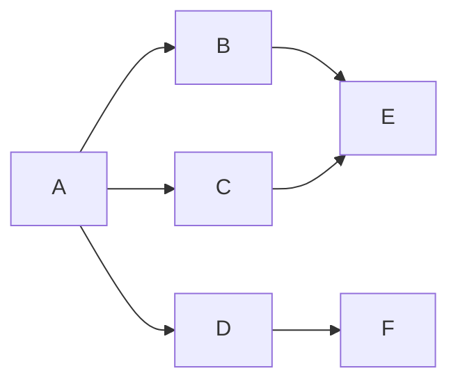

# Concurrent Task Execution Engine

_This is a personal project currently under development. The API, implementation, tests, and benchmarks may change as the project evolves._

Concurrent Task Execution Engine is an exploration of how to build a small runtime for executing computational work efficiently across multiple CPU cores. The long-term goal is to move beyond independent tasks and support dependency graphs in which tasks become eligible for execution only after their prerequisites have completed.

For example, given a graph in which `A` precedes `B`, `C`, and `D`, the engine should execute `A` first, run the newly eligible tasks concurrently, and release subsequent tasks such as `E` and `F` as their dependencies are satisfied.

## Project direction

The project is intended to evolve around several cooperating components:

- a **task graph** that tracks tasks, dependencies, execution state, results, and failures;
- a **dependency manager** that determines when tasks become eligible to run;
- a **scheduler** that assigns eligible work according to a chosen strategy;
- a fixed **worker pool** that executes work and reports completion;
- interchangeable queueing strategies, progressing from a shared queue toward per-worker queues and **work stealing**.

Work stealing is a particular area of interest. Allowing idle workers to take work from busy workers could improve load balancing, but introduces deeper questions around synchronization, exactly-once execution, deadlock prevention, efficient sleeping and waking, and the trade-offs between lock-based and lock-free queues.

## Current state

The current implementation establishes the initial shared-queue worker-pool foundation:

- submission of `Action` work items through a small public `TaskEngine` API;
- a fixed-size pool of background worker threads;
- a custom single-producer, multiple-consumer queue;
- graceful shutdown that drains accepted work before workers stop;
- initial xUnit tests and benchmark scaffolding for comparing concurrent and sequential execution.

Upcoming work includes stronger error and result propagation, broader concurrency testing, performance experiments across different worker counts and workload sizes, dependency-aware execution, and more advanced scheduling strategies.
